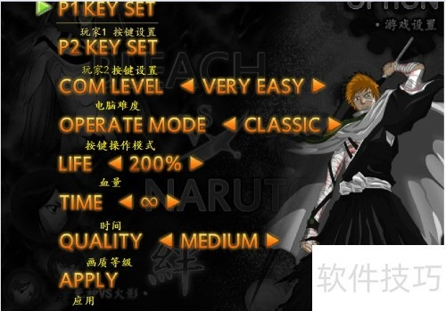

# 《死神 VS 火影》横纵分析报告
> 研究时间 2026-11-24 · 同人 2D 格斗与平台格斗 · 梗角色大乱斗团队战斗设计参考

## 一、研究结论

《死神 VS 火影》的共享动作键让玩家快速试出角色基本动作，距离、资源和受击后的应对则给对战带来更深的取舍。对《梗角色大乱斗》，优先级最高的是让同一个输入在四位角色身上兑现同样的基本意图，同时允许角色在实现方式、威胁方向、节奏和反制上不同。[\[3\]](https://news.4399.com/xyxgl/201004-23-67120.html)[\[6\]](https://www.4399.com/flash/205551.htm)[\[23\]](https://github.com/5DPLAY-Game-Studio/BleachVsNaruto/blob/d51f13dc36cac8e7622328bf4a9afc94156fb79f/CORE_Shared/src/net/play5d/game/bvn/data/fighter/FighterInputCmd.as#L31-L91)

本次对当前工作树的审计发现，四名角色各有一招三格气的大招。姑姑嘎嘎的地空炮台是两个扣杀气的普通技。四人均未完整接通项目说明里的「前段普攻命中 → 挑空 → 起跳追击」。现有大招变体的数据结构也没有覆盖所有已合入角色的播放分支。直接给四名角色各添一招，会触及输入仲裁、HUD 与资源状态。先补这些共用规则，角色作者才能各自按清楚的契约提交。

**建议基线。** 普通技能一律消耗 0 杀气。保留 J 普攻、W+J 挑空、U 进攻技、I 特色技、O 角色代表大招。每名角色新增一招上+O 战术大招，默认两招，第三个下+O 待用途和反制确认后开放。每角色仍保留其原创攻击、位移、眼泪、强化、炮台及演出。出招意图、姿态失败、气量反馈、命中反应和接入测试采用统一标准。

本报告依次给出本地实况、BVN 的历史与按键、战斗机制、横向对照、横纵交汇和落地顺序。另附团队可直接评审的[角色与战斗统一设计规范 v0.1](角色与战斗统一设计规范_v0.1.md)。结论中的按键和成本为本项目方案，建议参数需经联调确定。

## 二、先检查《梗角色大乱斗》

### 可玩循环和主要状态

实跑时工作树以 `bbd48c0` 为基底，包含角色图与构建脚本的在途改动。研究结束时同批素材已合入 `b7324b6`，两版相关源码差异仅为四名角色的美术路径，战斗、键位与 HUD 逻辑一致。使用当时项目文件执行 `npm run build` 成功，以 Chrome 1280×800 打开新构建的离线 `dist/index.html`，通过自动发送浏览器按键事件和原有 UI 跑对战。训练使用直播擂台，逐动作测试使用调试面板和半速。设为静音以重复观察输入和视觉反馈。项目战斗内核以 60 Hz 固定步推进，浏览器以资源和显示节奏绘制。

| 场景 | 实际观察 |
| --- | --- |
| 本地双人 | 标题→本地双人→双确认→直播擂台→VS→开战。P1 大肥鱼和 P2 姑姑嘎嘎向中间移动，发送 J 与逗号；P2 生命 1000→955，P1 最终以 1∶0 超时领先。记录无页面异常。 |
| 大肥鱼练习 | 站立 W+J 显示「左转抽尾」。陪练开防后近距离 J 显示陪练「格挡 · 7 帧」，生命 1000，耐力 100→50，蓝色格挡效果与接触面可辨。 |
| 奶蛙练习 | 站立 W+J 显示「左拳」。充满三格按 O，从「神了！」起手切换到「强化剩余 14.0 秒」。强化期间气量显示由倒计时接管。 |
| 香蕉猫练习 | W+J 显示「向上挑击」；起始 60 泪，U「高压眼泪」击中陪练，扣到 40 泪，画面出现 32 伤害，公共气净增 12。长按 I 显示「哭泣」，泪量逐渐回升。 |
| 姑姑嘎嘎练习 | U 显示「专属槽 B 待接入」。I 在 0 气不出招；充气后地面 I 显示「部署双管炮塔」，扣到 200。HUD 就绪标记为真，当时 O 仍不能启动。W+J 显示「冲锋挑击」。 |

首轮截图和输入日志见同目录 `evidence/`。本轮只读分析覆盖菜单到结算、关键动作和训练反馈。本轮以静音方式观察，听感、真实键盘吞键、移动浏览器与手柄均需专门复核。源码定向验证目前为 158 个现存用例通过，另外用当前核心在临时目录探测四人挑空、三格扣费以及追加方向大招后的输入选择。源码和实跑在本节分开表述。

### 目前实际招式输入矩阵

P1 左右 A/D、上 W、下 S（地面防御）、K 跳、L 冲刺、J 普攻、U/B、I/C、O/ULT。P2 方向键、右 Shift、Enter、逗号、句号、斜杠、单引号，对应默认小键盘 2/3/1/4/5/6 备用输入。别名只有默认键仍有效、且没有已经被其它键位占用时才补入。键按下时采样方向，系统自动连发不会重复加入攻击。

| 角色 | 地面／空中 J 与 W+J | U | I | O |
| --- | --- | --- | --- | --- |
| 大肥鱼 | 三段尾击，末段挑飞；空中尾击；W+J 匹配首段 | 米饭投手，W+U 60°上投，地空可用，有偷吃分支 | 地面推进旋风，W+I 定点旋风；正面铁盆专有防反 | 地面「开源！」，300，水潭锁点、预警、最多 12 段 |
| 奶蛙 | 五段拳脚、末段击飞；空中踢；W+J 匹配左拳 | 捧腹大笑近身多段，W+U「响彻天地」全场；常态地面、强化可悬空 | 蹲守触发绕背；W+I 钻到敌人脚下 | 地／空「神了！」，300，演出后强化约 15 秒模拟时间 |
| 香蕉猫 | 四段普攻；W+J 挑击，S+J 泪滑；空中水球扣 10 泪且零泪无后备 | 高压眼泪首段扣 20 泪，持续再扣；W+U 哭哭升龙耗 35 泪 | 长按哭泣每秒回 20 泪，开局 60／100 | 地面「泪海滔天」，300，前摇可打断，转入特写后放浪，可格挡 |
| 姑姑嘎嘎 | 五段普攻；W+J 冲锋挑击、S+J 滑铲；空中投杆 | 未接入主动技能 | 地面双管炮塔／空中榴弹炮，各扣 100 杀气；现实现为每类全场一座 | 地面「帝江」，300，特写及沿场俯冲，可带下高处目标，忽略普通格挡 |

角色定义与接口定位见 文末的本地索引 L1–L6。香蕉猫的眼泪是专属资源。上表的其余普通技能均无公共气消耗，奶蛙绕背成功可在常态加气。公共气初始为 0，每格 100，默认命中方／承伤方 +20／+10；猫与嘎嘎改为 +12／+18。连续命中、固定伤害及实体的回气事件随路径而不同。由此可见，等价的两格售价未必给四个角色相同的大招可用频率。新招平衡需要实测回气节奏。[L3][L6][L7]

### 接口在哪些地方产生差异

`defineFighter` 会整体选用角色自定义公共动作或公共默认集合。默认 `common-launch` 才现成带 K 跳消。鱼、蛙各自的 `commonMoves` 没补独立 W+J，猫、嘎嘎有挑空但缺挑空命中跳消，前两段 J 也没给挑空取消。在地面接段上，猫、嘎嘎的 `chain` 接续窗口允许三个命中结果推进；鱼、蛙还有 `chainAfter` 提前许可路径，打空也可续。给某个技能写了 `cancelOnHit` 不等于所有情况下都要求命中，奶蛙甚至能据其接 B 或 ULT。新规范把「同槽普攻接段」和「跨槽确认取消」分别约束。[L2][L4][L8]

大招 `ultimate.variants` 当前可配成本和输入。联调样例验证了数据层可表示 100、200、300。泪海与帝江有更早的特写／召唤入口，匹配数组首项便消耗命令。临时探针追加一个 W+O 一格普通大招后，满气 W+O 仍各触发原本的三格电影招。鱼水潭和蛙强化另有特例，奶蛙强化直接回填气字段作倒计时。通用 HUD 又把 `energy >= 100` 记为就绪，选角只展示单一成本。把输入选择、资源提交与演出入口合并，是给四人并行编写第二招之前的系统改造。[L6][L9][L10]

项目已经有动画时间轴、逐帧攻击和受击判定、命中组、生成实体、投射物、特效和声音接口。受击框时间轴内未覆盖的区间可能没有实际受击框，要以当前实现和数据明确验证。鱼饭团的独立实体可以显式写入动作命中状态，其他实体未必具备同样的命中确认。猫的水球与波、嘎嘎投杆与炮弹还通过另一投射物路径处理，帝江和炮台有专有状态。两类实体应先纳入统一测试和交接，保留经验证合适的实现。[L11][L12]

### 已有受击状态和风险区

现行普通格挡为地面正面防御，零削血。独立耐力 100，耗尽后破防 45 帧，恢复到 50。普通扣耐后等待 60 模拟帧开始恢复，地冲／空冲分别耗耐 20／30。大肥鱼的铁盆持续防反、奶蛙蹲守绕背通过角色特例生效。防守者面向或攻击来源不正确时，格挡结果会变化。多层图与大位移能够制造换边，角色验收时须用实际两面与空中状态跑测试。[L3][L7][L13]

命中停顿上限 6 帧、格挡和防反停顿上限 3 帧、单段连击累计停顿上限 60。地面正常硬直结束后可重获操作。浮空受控期间允许追击，落地启动倒地；强制倒地或保护下落可进入不可被追击状态。默认倒地 30 加起身 18 帧，连续受控达到 180 个非冻结帧时保护倒地。普通伤害随连击次数下降，每次基础值减 8%，下限 35%。鱼／蛙的一些固定伤害与专有实体路径绕过此缩放。这些状态都值得观测，读条动画或特效长短无法独立证明受击硬直和可操作帧。[L3][L7][L13]

项目先前已经针对 BVN 单独审过走位、空中资源和战斗 HUD。已有设计框架把公共入口、角色数据和菜单职责拆开。本轮建议沿现有边界推进，主界面由用户决定，战斗 HUD 只补可用状态的准确性与教练信息。五张图仍以原地图落脚规则验收，单层直播擂台的表现不能代替多台阶的纵向反制测试。[L14][L15]

## 三、纵向演进

### 2007–2010 年，先让两个玩家识别招式并迅速开打

2022 年采访剑jian 的机核文章记录，作者早期自学 Flash、经营个人站点和制作《死神的试炼》。他从《拳皇97》的长期对战吸引力找到做格斗的方向，早期 BVN 的小比例角色、较大可移动范围和低搓招门槛则借鉴了 NDS《Jump 终极全明星大乱斗》。该文还把《撕裂重罪》与 BVN 的界面和音乐相联系。这里的启发有层次，《拳皇97》解释为什么做格斗，《Jump》更能解释场地和输入为什么长成这样。[\[1\]](https://www.gcores.com/articles/151199)

4399 的双人游戏目录明确记录 2008-04-25 收录 0.8。2007-12-09 的 0.1 出自玩家数据库，2010 年的 4399 攻略又称最早发布 0.2。首个公开版本和首发日期存在来源分歧，能确认的起步范围是 2007–2008 年，能确认的网页节点是 0.8 收录。2010-04-24 的 1.0 出招表已经列出双人同机、练习、J/U/I 上下变招、援助、快速起身、满三格气变身和绯村剑心。机核把剑心加入记作 1.3，这一点与同期 1.0 出招表冲突，应以“1.0 时已经出现”为最稳结论。开发者官号在 2024 年亦发布过剑心和 4.0 进展的访谈，标题和简介能核实主题。[\[1\]](https://www.gcores.com/articles/151199)[\[2\]](https://www.4399.com/special/1111.htm)[\[3\]](https://news.4399.com/xyxgl/201004-23-67120.html)[\[4\]](https://bgm.tv/subject/309060)[\[5\]](https://space.bilibili.com/1340107883)

**判断。** 可立即使用的连按和方向变招，使玩家可以一开始凭原作角色辨识来试招，之后靠反复对战学位置、时机和耗气。这里的入门路径是“看到动作 → 试出用途 → 认识什么时候会被反打”，和在选人前背一长串招式相比摩擦更小。

### 1.7 到 3.3，移动成为攻防共用的资源

机核采访把幽步引入记在 1.7。幽步既可脱离潜在命中，也可消除某些技能僵直后衔接。伴随角色增加，可变形态和援助也拉开角色打法。社区自行禁无限连、分档选手和角色的做法，说明华丽连段与同水平对战的公平性之间已有张力。关于 2.4 三段剑心过强与 2.5 移除的叙述出自采访稿，适合作为带出处的案例，无需外推出任何版本的伤害值。[\[1\]](https://www.gcores.com/articles/151199)[\[11\]](https://bvn.huijiwiki.com/wiki/TerminologyDictionary)

4399 记录 2.6 于 2016-06-29，新增角色涅茧利和奇拉比，并增加援助。机核采访记载 2017 年 3.0 经 AS3 重制，加入耐力与小队模式并推出原作者团队的安卓版。社区编辑台账据 4399 记到 2017-07-01，并补充投技及不同平台地图。团队相关参与者 SHEN-ZILLA-44 的 2022 年整理也将 0.6–2.6 记为 AS2、3.0–3.6 记为 AS3，并区分 2.6 及以前的移动端模拟器运行与 3.0 起的 Android 正式包。把“原作者正式 Android”“原 Flash 经模拟器运行”“改版资源打包”当作三个概念可避免误解。[\[1\]](https://www.gcores.com/articles/151199)[\[7\]](https://www.4399.com/flash/176245.htm)[\[8\]](https://www.bilibili.com/read/cv2618415/)[\[9\]](https://bvn.huijiwiki.com/wiki/%E6%9C%AC%E7%AB%99%E7%BC%96%E8%BE%91%E6%8C%87%E5%8D%97/%E5%AE%98%E6%96%B94.0%E4%BA%BA%E7%89%A9%E5%8D%A1%E7%89%87%E7%BC%96%E8%BE%91%E4%BA%8B%E9%A1%B9)

4399 3.2 于 2018-07-27 上架，列出葛力姆乔、宇智波斑和新援助。4399 3.3 于 2019-04-30 收录，列出半虚一护、神威卡卡西、佩恩重制，部分动作增加钢身，白哉加入援助、夜一援助重制、部分援助有增益。2019-04-21 的 SHEN-ZILLA-44 安卓资料把该一护变身写为 `S+JK`，4399 3.3 网页介绍则写 `J+K`。两者至少存在口径差异，不能据两页合并出所有形态的默认按法。[\[6\]](https://www.4399.com/flash/205551.htm)[\[8\]](https://www.bilibili.com/read/cv2618415/)[\[10\]](https://www.4399.com/flash/199408.htm)

**判断。** 到这一阶段，积气变成在进攻终结和容错之间分配，耐力把防、闪、断连、抢位连在一起。教程若把气只解释为“大招条”，玩家会看懂槽条的长短，却很难领会保留资源对下一轮走位的价值。

### 2020 年以后，Flash 旧版保留，竞技内容和开发工程并行

Adobe 在 2020-12-31 结束 Flash 支持，2021-01-12 起阻止 Flash Player 跑内容。这个节点改变了网页入口，并不证明 AS3/AIR 等产品分支终止。2022 年采访稿回顾了 2021 年 3.5 的无双模式、团队摸索 Unity 及 2022 年 2 月发布 Unity 试玩，已有 2022-02-09 玩家试打影像佐证。文中把 3.6 称作最后的 Flash 版，应理解为当时的路线描述，和后续 AS3 活动分开看，不能说所有分支在 3.6 后都停更。2024 年制作方官号访谈仍将 4.0 开发进展列为议题。本次没有一手证据给 4.0 宣布正式完工或最新稳定包。[\[1\]](https://www.gcores.com/articles/151199)[\[5\]](https://space.bilibili.com/1340107883)[\[13\]](https://www.adobe.com/uk/products/flashplayer/enterprise-end-of-life.html)[\[14\]](https://www.bilibili.com/video/BV1pS4y1C7jN/)

社区比赛改版开始于玩家组织。SHEN-ZILLA-44 的归档把 2.5 雨幕版记为首个竞技改，把 2.6 的分阶选禁和连段限制记为后续调整，并称 3.4 S6 正式纳入官方。2023-04-29 的制作方账号正式公告 3.8.0 竞技版，2026-05-01 正式公告 3.8.8，明确提到阿飞、卍解市丸银和其他角色调整。2026-05-02 有玩家实录标示 3.8.8.4，具体最新补丁缺制作方一手版本公告。官方 B 站账号的索引还列 2026-08-25 的卍虚玩法调整、10-31 发布的万圣内容与比赛录像。该索引有时跳浏览器提示，因此以它证明近期活动，不能给软件包补发行日。[\[5\]](https://space.bilibili.com/1340107883)[\[8\]](https://www.bilibili.com/read/cv2618415/)[\[15\]](https://www.bilibili.com/opus/789947633874501666)[\[16\]](https://bvn-sports.com/)[\[17\]](https://www.bilibili.com/video/BV1exR5BPE1m/)[\[18\]](https://search.bilibili.com/zh-Hans/all?keyword=%E6%AD%BB%E7%A5%9EVS%E7%81%AB%E5%BD%B1%E5%90%A7%2F)

与此同时，5DPLAY 公开的 `OpenBleachVsNaruto` 是已归档的 3.4 调试工程。主公开 `BleachVsNaruto` 仓库明确自称 ActionScript 3.0、3.7 Alpha，2026-08-31 增练习模式输入历史，2026-10-29 增飞行物命中后的延迟回调并拆分人物包。本次逐行核查用的 `d51f13dc36cac8e7622328bf4a9afc94156fb79f` 本身提交于 2026-10-29 14:44:21（北京时间）。3.7 Alpha 的新日期与竞技版已发布 3.8.8 可同时成立。[\[19\]](https://github.com/5DPLAY-Game-Studio/OpenBleachVsNaruto#工程状态)[\[20\]](https://github.com/5DPLAY-Game-Studio/BleachVsNaruto/blob/master/CHANGELOG.md#370010292026_alpha---2026-10-29)[\[21\]](https://github.com/5DPLAY-Game-Studio/BleachVsNaruto/blob/master/README.md#工程状态)[\[22\]](https://github.com/5DPLAY-Game-Studio/BleachVsNaruto/commit/d51f13dc36cac8e7622328bf4a9afc94156fb79f)

## 四、BVN 按键设置与出招输入

| 意图 | 1P 默认 | 2P 默认 | 解释 |
| --- | --- | --- | --- |
| 水平移动 | A、D | ←、→ | 接近、远离、改变出招朝向 |
| 防御 | S | ↓ | 与下方向共用 |
| 近攻 | J | 1 | 连按能进入部分人物的普攻链 |
| 跳跃 | K | 2 | 空中再按 J 或 U 可发动空中招式，少数人物有空中 I |
| 瞬步 | L | 3 | 与快速起身、幽步共用同一动作键 |
| 招式键 | U | 4 | 页面称远攻，功能随角色，可承担道具、区域控制或近身特殊技 |
| 必杀 | I | 5 | 方向组合以及少数角色空中用 I 都可能对应不同招式 |
| 召唤援助 | O | 6 | 受击时同键变成反击或脱离入口，受状态和资源约束 |
| 上、下变招 | W/S + J、U、I | ↑/↓ + 1、4、5 | 方向是选招，结果由人物制作。并非所有 W 技都朝上或每个 I 槽都成立 |
| 幽步 | S+L、W+L | ↓/↑+3 | 地面 S+L、向上 W+L。空中 S+L 可能朝下，详见版本机制 |
| 快速起身 | 倒地瞬间 L | 倒地瞬间 3 | 4399 的操作提示与受击按 O 的反击不同 |
| 下台阶 | S+K | ↓+2 | 社区术语和 3.7 源码有对应指令。适用于可下穿的平台 |
| 变身 | J+K 或人物特定方向组合 | 1+2 或对应组合 | 1.0、3.3 页面写 J+K 的个案，3.7 代码另有 WJK/SJK，需人物提供相应形态 |

主要依据为 4399 3.3 默认键位及 1.0 对照。[\[3\]](https://news.4399.com/xyxgl/201004-23-67120.html)[\[6\]](https://www.4399.com/flash/205551.htm)[\[11\]](https://bvn.huijiwiki.com/wiki/TerminologyDictionary)[\[23\]](https://github.com/5DPLAY-Game-Studio/BleachVsNaruto/blob/d51f13dc36cac8e7622328bf4a9afc94156fb79f/CORE_Shared/src/net/play5d/game/bvn/data/fighter/FighterInputCmd.as#L31-L91) 近身投技，4399 简写“近身 J 或 U”，社区记法和 3.7 训练输入根据同按的方向显示 A/D+J 或 A/D+U。3.7 源码还对目标能否被抓作检查，不宜把单按 J 或 U 普遍写成投技。[\[6\]](https://www.4399.com/flash/205551.htm)[\[11\]](https://bvn.huijiwiki.com/wiki/TerminologyDictionary)[\[24\]](https://github.com/5DPLAY-Game-Studio/BleachVsNaruto/blob/d51f13dc36cac8e7622328bf4a9afc94156fb79f/CORE_KernelLogic/src/net/play5d/game/bvn/fighter/ctrler/mc/FighterMcFloorHandler.as#L290-L423)

4399 同将 `WJ、SJ、U、WU、SU` 归入“无视防御技能”。这是页面的粗粒度 UI 指南。它与社区对防御、拼招、破防、钢身及各种招式用途的分解并不等价，3.7 源码也检查当前朝向、抓取/破防属性和防御能力。具体哪些 3.3 角色招无条件越过格挡，应对实际人物、方向和耐力逐项测试。因此需逐角色区分可格挡、削耐、破防或抓取。[\[6\]](https://www.4399.com/flash/205551.htm)[\[11\]](https://bvn.huijiwiki.com/wiki/TerminologyDictionary)[\[25\]](https://github.com/5DPLAY-Game-Studio/BleachVsNaruto/blob/d51f13dc36cac8e7622328bf4a9afc94156fb79f/CORE_KernelLogic/src/net/play5d/game/bvn/fighter/ctrler/mc/FighterMcHurtCtrl.as#L308-L321)[\[26\]](https://github.com/5DPLAY-Game-Studio/BleachVsNaruto/blob/d51f13dc36cac8e7622328bf4a9afc94156fb79f/CORE_KernelLogic/src/net/play5d/game/bvn/fighter/models/HitVO.as#L68-L100)

### 各版本的默认键位与改键设置

3.3 的 P2 数字说明通常指小键盘，主键区数字行需单独验证。3.3 网页 4399 的说明只公布默认键和特殊动作，包含画质、音量更新说明。一份 2017 玩家操作演示实际记录了 3.0 的 Options 改键页面。3.3 时代的老玩家整理和数字键 FAQ 也报告可在设置改数字键。2019 安卓 3.3 消息提到自定义按键，同一条资料将一护某变身写作 S+J+K，4399 网页收录写 J+K。普通变身的三格要求有 1.0 同期资料与标注 3.3 的后期攻略旁证，本轮未逐角色测资源。平台、角色及形态都必须写全。[\[58\]](https://m.namu.moe/w/%EB%B8%94%EB%A6%AC%EC%B9%98%20vs%20%EB%82%98%EB%A3%A8%ED%86%A0#s-2.1)[\[59\]](https://3g.ali213.net/gl/html/1612323.html)[\[6\]](https://www.4399.com/flash/205551.htm)[\[8\]](https://www.bilibili.com/read/cv2618415/)[\[10\]](https://www.4399.com/flash/199408.htm)[\[52\]](https://jingyan.baidu.com/article/656db918cc3a31e380249c40.html)

较接近经典版本的 3.4 调试工程设有独立 P1／P2 Key Set。3.7 Alpha 固定提交把 1P 预设写成 W/S/A/D 加 J/K/L/U/I/O，2P 则为箭头及 NumPad1–6。设置界面源码列四方向和攻、跳、冲刺、技能、必杀、特殊项，并提供全量设置、恢复默认、应用与取消。操作按键被解析为逻辑输入，所以上下按键变化也作用于方向组合。设置实现中「特殊」这一项的显示读取与写入字段名字有差异，需运行验证特殊键的重新指定。可证明选项存在及显示范围。移动端经典与自定义操作有自己版本语境，3.6 的触控按键摆位和大小需要按该移动版本理解。[\[60\]](https://github.com/5DPLAY-Game-Studio/OpenBleachVsNaruto/blob/e3bc6092e1f62213bcdc3c34664cb2da2d2a6b8a/swf_source/%23FighterTester/src/net/play5d/game/obvn/stage/SettingStage.as#L62-L81)[\[23\]](https://github.com/5DPLAY-Game-Studio/BleachVsNaruto/blob/d51f13dc36cac8e7622328bf4a9afc94156fb79f/CORE_Shared/src/net/play5d/game/bvn/data/fighter/FighterInputCmd.as#L31-L91)[\[55\]](https://github.com/5DPLAY-Game-Studio/BleachVsNaruto/blob/d51f13dc36cac8e7622328bf4a9afc94156fb79f/CORE_KernelLogic/src/net/play5d/game/bvn/data/vos/ConfigVO.as#L73-L98)[\[56\]](https://github.com/5DPLAY-Game-Studio/BleachVsNaruto/blob/d51f13dc36cac8e7622328bf4a9afc94156fb79f/CORE_KernelLogic/src/net/play5d/game/bvn/ui/settings/SetCtrlBtnUI.as#L109-L216)[\[57\]](https://a.4399.cn/gg/38935020_260850.html)

与本项目相同的是 A/D、S 与 J/K/L 的动作意图，以及短修饰进入变招的方式。经典 3.3 的 I 是必杀，O 是援助或受击反击；我方 I 是特色普通技，O 是大招。对照研究中，3.3 论坛演示和 3.7 代码中的技能功能均不用于改写这两项我方槽位。下+K 的说明只用于可穿透台阶；空中或平地、默认 O 和变身的精确行为须按具体版本人物核对。[\[6\]](https://www.4399.com/flash/205551.htm)[\[11\]](https://bvn.huijiwiki.com/wiki/TerminologyDictionary)[\[23\]](https://github.com/5DPLAY-Game-Studio/BleachVsNaruto/blob/d51f13dc36cac8e7622328bf4a9afc94156fb79f/CORE_Shared/src/net/play5d/game/bvn/data/fighter/FighterInputCmd.as#L31-L91)[\[55\]](https://github.com/5DPLAY-Game-Studio/BleachVsNaruto/blob/d51f13dc36cac8e7622328bf4a9afc94156fb79f/CORE_KernelLogic/src/net/play5d/game/bvn/data/vos/ConfigVO.as#L73-L98)

### 实际访问与影像核对

**实见设置画面。** 标明 3.2 的中关村在线资料保留了游戏内 Options 截图。打开原图可读到独立的 **P1 KEY SET、P2 KEY SET**，以及 **OPERATE MODE CLASSIC、APPLY**。配文进一步列逐项设置、全量录入和确定。它记录了 3.2 时期附近的设置结构，和 3.4 调试工程、3.7 Alpha 设置源码吻合。3.3 网页具体能否逐项绑定及跨刷新保存仍待运行验证。[\[60\]](https://github.com/5DPLAY-Game-Studio/OpenBleachVsNaruto/blob/e3bc6092e1f62213bcdc3c34664cb2da2d2a6b8a/swf_source/%23FighterTester/src/net/play5d/game/obvn/stage/SettingStage.as#L62-L81)[\[67\]](https://soft.zol.com.cn/1054/10542444.html)

*3.2 游戏内 Options，画面取自中关村在线 2025-10-03 的设置指南。来源为该公开图文。* [\[67\]](https://soft.zol.com.cn/1054/10542444.html)

**3.3 发行与模拟。** 4399 的原网页收录条目可读，嵌入区域提示当前浏览器不支持其 Flash 启动路径。Snokido 的 Controls 面板确实列出 1P 和 2P 对照、方向招式与 J+K；点击 Play Now 之后主站停在 Ruffle 加载，备用入口未进游戏。独立访问 BVNPlay 3.3 超过 52 秒仍留在「LOADING...」，轻量 2.6 入口也停黑屏。台版 GameBox 的列表写 3.3，嵌页自己的启动屏标 3.01，按后者认定版本。未用这些页面代替 3.3 游戏内设置画面。[托管页控制面板](evidence/snokido-host-controls.jpg) · [首次访问记录](evidence/controls.json) · [后续加载记录](evidence/fast-watch.json) [\[6\]](https://www.4399.com/flash/205551.htm)[\[39\]](https://www.snokido.com/game/bleach-vs-naruto)[\[53\]](https://www.bilibili.com/video/BV1S54y1z7XC/)[\[68\]](https://www.gamebox.tw/game/51)

**3.3 PC 实战录像。** 实际观察到 Andréj 2019-05-01 录像约 0:48 和 1:20 的对战画面。约 0:48，双方在同一平面拉开，一侧跑动，另一侧位置被烟尘效果覆盖。两侧生命、中央无限时与底部分开显示的槽可同屏辨认。约 1:20，角色在街景右侧相接，接触区域有多个烟团和掀起地面的效果，至少一侧生命条明显缩短。画面展示了位置、命中表现与生命信息如何同屏传达。单个片段没有输入显示，切换码率及定位也有超时，不能用作招式归因、格挡类型或精确帧数证据。[约 0:48](evidence/bvn33-video-0048.jpg) · [约 1:20](evidence/bvn33-video-0120.jpg) · [录像原页](https://www.youtube.com/watch?v=XYalwWONHfA&t=48s) [\[51\]](https://www.youtube.com/watch?v=XYalwWONHfA)

## 五、BVN 的战斗系统

### 地面、空中和角色攻击

**3.3 可证。** 普攻、技能、必杀的按键家族让玩家能复用肌肉记忆，实际角色分工依靠攻击覆盖、起手速度、防护、冲到多远、命中后位移及落点。3.0 社区新手文将春野樱 SU、李洛克 WU、剑心 SJ 当作不同角色用于抓瞬步落点的例子，反映功能等价的招可以分配给不同指令。玩家 3.3 无限连样本有 2019-07-12 的“无瞬步无限连”和 2025-08-31 的网页版演示。它们证明会有玩家钻研循环，并不能在未知训练条件下等同于常规比赛可保证循环。[\[6\]](https://www.4399.com/flash/205551.htm)[\[11\]](https://bvn.huijiwiki.com/wiki/TerminologyDictionary)[\[27\]](https://bvn.huijiwiki.com/wiki/%E6%96%B0%E6%89%8B%E6%94%BB%E7%95%A5%E2%80%94%E2%80%94%E5%B8%A6%E4%BD%A0%E8%B5%B0%E8%BF%91%E8%B4%B4%E5%90%A7%E7%BA%A7%E7%8E%A9%E5%AE%B6)[\[28\]](https://www.bilibili.com/video/BV1Qt41157Jx/)

**3.7 固定提交可证。** 地面走动可按输入翻转朝向，空中可移动；空冲和再次起跳共用预留机会，空冲会清空剩余次数，空中普通攻击可扣空击次数并清空跳跃次数，空中 U 可按角色配置区分上下变招，空中必杀单独检查气量和动作。地面主动变空招与空中接地面招都要满足“正在攻击”且角色动作开放的条件，不能推成全角色自由取消。连段兼顾碰撞、位移、出招时间窗口和后续动作是否允许四件事，普攻链是入口，幽步或某些预先配置的衔接是另一路。[\[23\]](https://github.com/5DPLAY-Game-Studio/BleachVsNaruto/blob/d51f13dc36cac8e7622328bf4a9afc94156fb79f/CORE_Shared/src/net/play5d/game/bvn/data/fighter/FighterInputCmd.as#L31-L91)[\[24\]](https://github.com/5DPLAY-Game-Studio/BleachVsNaruto/blob/d51f13dc36cac8e7622328bf4a9afc94156fb79f/CORE_KernelLogic/src/net/play5d/game/bvn/fighter/ctrler/mc/FighterMcFloorHandler.as#L290-L423)[\[29\]](https://github.com/5DPLAY-Game-Studio/BleachVsNaruto/blob/d51f13dc36cac8e7622328bf4a9afc94156fb79f/CORE_KernelLogic/src/net/play5d/game/bvn/fighter/ctrler/mc/FighterMcAirHandler.as#L262-L413)[\[30\]](https://github.com/5DPLAY-Game-Studio/BleachVsNaruto/blob/d51f13dc36cac8e7622328bf4a9afc94156fb79f/CORE_KernelLogic/src/net/play5d/game/bvn/fighter/ctrler/FighterActionLogic.as#L105-L188)

### 三个角色的实招差异

**1.0 绯村剑心，普攻和前方破防的分工。** 2010-04-28 同期实测稿记录，J 连按三段从近身进入，末段后对手可能还在空中。W+J 出手较慢，在正面攻击范围内可以两段全中，目标从身后进入时可能只吃后段，且测试记载正面部分可破防。续接 U／I 要看被打者的高度、间距和硬直是否已经结束。对方能恢复防守或瞬步时，追招可能落空，施放者暴露在反制范围里。S+I 的三格超必杀会受相对位置与对手落地防御影响。稿件自己标明测量误差。可迁移的做法是保留一条启动快的共享近攻，同时给识别方向、距离和收招的人更有条件的收益。[\[40\]](https://news.4399.com/xyxgl/201004-28-67373_2.html)[\[61\]](https://news.4399.com/xyxgl/201004-28-67373.html)

**3.3 宇智波斑，同层压制和向上封位。** 一个标注 3.3 的玩家连段记录可确认该版本有玩家演练过斑的衔接。一份 2023 年的转载攻略把斑的 U、W+U 分别描述为同层压制和对空，并建议考虑连续 J 打高目标后改变的落点。这是待验证的招式用法。原始录像标题能支持存在对应角色连段，当前观察不足以确认这几项具体指令、命中和格挡结果。设计推断是给较长的同层覆盖配合可见的收招，让跳换高度、离开最佳射程或从另一时机进攻成为候选反制。这适用于我方米饭、眼泪和炮台，但三个招式的位移与使用成本可以不同。[\[10\]](https://www.4399.com/flash/199408.htm)[\[62\]](https://www.bilibili.com/video/BV1UK41157o7/)[\[63\]](https://m.downza.cn/xy/180698.html)

**3.4 调试工程未卍解一护，前移连击、钢身与变身。** 固定开源的第一个 `ichigo` 时间线定义 J→J→J 逐段开放，前两段短前移，第三段攻击区偏高并有上推。后段再显式开 S+U、W+U、S+J 或 L。S+J 扩展身前判定并在指定区间开钢身，再关闭、进入收势，命中数据带击飞。S+I 的有效区域向身前移动，定义给出强推和击飞，演出末回待机。J+K 有闪光与震动，随后切换角色配置，3.4 通用变身入口消耗三格。由结构可推断，短前移与开钢身的时机使这组近身动作有自己的威胁窗口，变身威胁也会提高控制距离和安全开场的重要性。代码没有提供当前浏览器 3.3 的人类输入结果，哪些段落能抢断仍须对应版本操作。对我方的迁移是把钢身、攻击框、位移和例外取消明写进招式定义，让团队和玩家核对同一时序。[\[64\]](https://github.com/5DPLAY-Game-Studio/OpenBleachVsNaruto/blob/e3bc6092e1f62213bcdc3c34664cb2da2d2a6b8a/swf_source/f_fighter/ichigo/LIBRARY/%E5%85%83%E4%BB%B6/mc_0059.xml#L189-L277)[\[65\]](https://github.com/5DPLAY-Game-Studio/OpenBleachVsNaruto/blob/e3bc6092e1f62213bcdc3c34664cb2da2d2a6b8a/swf_source/f_fighter/ichigo/DOMDocument.xml#L2088-L2103)[\[66\]](https://github.com/5DPLAY-Game-Studio/OpenBleachVsNaruto/blob/e3bc6092e1f62213bcdc3c34664cb2da2d2a6b8a/swf_source/%23FighterTester/src/net/play5d/game/obvn/fighter/ctrler/FighterMcCtrler.as#L1393-L1404)

三招看起来都叫「普通技」，其对局用途可以各异。剑心靠速度和前向承诺，斑靠同层空间，一护靠移动与钢身窗口。共享输入负责告诉玩家动作要解决的问题。角色本身的差异由威胁方向、持续时间、落点、成本、后续与反制构成。

### 两种角色资源与援助

**3.3 口径。** UI 和 4399 页面可证 I/WI/SI、特定空中 I、幽步、快起、援助/受击反击都存在。社区词典作为玩家机制记录，描述攻防消耗的是耐力，幽步另外耗气，灵爆/替身需要一格气并大量消耗耐力，援助使用自己的冷却。用“常见一格小必杀、三格超必杀/变身”表述有跨版本旁证，精确值应标定版本和角色，3.3 的每个角色此处缺少完整实测。[\[3\]](https://news.4399.com/xyxgl/201004-23-67120.html)[\[6\]](https://www.4399.com/flash/205551.htm)[\[11\]](https://bvn.huijiwiki.com/wiki/TerminologyDictionary)[\[27\]](https://bvn.huijiwiki.com/wiki/%E6%96%B0%E6%89%8B%E6%94%BB%E7%95%A5%E2%80%94%E2%80%94%E5%B8%A6%E4%BD%A0%E8%B5%B0%E8%BF%91%E8%B4%B4%E5%90%A7%E7%BA%A7%E7%8E%A9%E5%AE%B6)

**3.7 固定提交可证。** `qi` 上限默认 300，UI 分三格；普通命中和受击各有加气路径，默认必杀命中造成方的这条回气系数为零；I/WI/空中 I 默认 100，SI 默认 300，接口可按招式传入耗气值；已配置的变身检查具体形态动画并消耗 300。耐力 `energy` 是单独状态，普通地面/空中瞬步和幽步能在一定条件下透支进入过载，防守耗尽会破防，受身也耗耐力。援助还有单独恢复的 `fzqi`。以下数值只用于释读 3.7 源码，地面瞬步 20、空中瞬步 30、三种幽步开头均检查 60 气并消耗 80 耐力，弹地受身 30 耐力。社区对 3.3 幽步的场景消耗描述与此统一入口已有差别。[\[24\]](https://github.com/5DPLAY-Game-Studio/BleachVsNaruto/blob/d51f13dc36cac8e7622328bf4a9afc94156fb79f/CORE_KernelLogic/src/net/play5d/game/bvn/fighter/ctrler/mc/FighterMcFloorHandler.as#L290-L423)[\[25\]](https://github.com/5DPLAY-Game-Studio/BleachVsNaruto/blob/d51f13dc36cac8e7622328bf4a9afc94156fb79f/CORE_KernelLogic/src/net/play5d/game/bvn/fighter/ctrler/mc/FighterMcHurtCtrl.as#L308-L321)[\[29\]](https://github.com/5DPLAY-Game-Studio/BleachVsNaruto/blob/d51f13dc36cac8e7622328bf4a9afc94156fb79f/CORE_KernelLogic/src/net/play5d/game/bvn/fighter/ctrler/mc/FighterMcAirHandler.as#L262-L413)[\[31\]](https://github.com/5DPLAY-Game-Studio/BleachVsNaruto/blob/d51f13dc36cac8e7622328bf4a9afc94156fb79f/CORE_KernelLogic/src/net/play5d/game/bvn/fighter/ctrler/mc/FighterMcGhostHandler.as#L50-L98)[\[32\]](https://github.com/5DPLAY-Game-Studio/BleachVsNaruto/blob/d51f13dc36cac8e7622328bf4a9afc94156fb79f/CORE_KernelLogic/src/net/play5d/game/bvn/fighter/FighterMain.as#L541-L578)[\[33\]](https://github.com/5DPLAY-Game-Studio/BleachVsNaruto/blob/d51f13dc36cac8e7622328bf4a9afc94156fb79f/CORE_KernelLogic/src/net/play5d/game/bvn/GameConfig.as#L102-L137)[\[34\]](https://github.com/5DPLAY-Game-Studio/BleachVsNaruto/blob/d51f13dc36cac8e7622328bf4a9afc94156fb79f/CORE_KernelLogic/src/net/play5d/game/bvn/ui/fight/QiBar.as#L108-L136)

### 格挡、瞬步、幽步、受击解围、钢身

**3.3 可证。** `S` 防守、`L` 冲刺、`W/S+L` 幽步、受击 `O`、着地窗口 `L` 是不同意图。普通走位／冲刺处理空间，格挡愿用耐力承受压力，幽步可拿来抢位或连接，受击 O 是已被打后争主动，落地受身是击飞阶段末的恢复。钢身和带增益援助是 3.3 更新说明明确可见的规则扩充。[\[6\]](https://www.4399.com/flash/205551.htm)[\[11\]](https://bvn.huijiwiki.com/wiki/TerminologyDictionary)

**3.7 固定提交可证。** 普通冲刺和幽步的执行分别维护自己的状态。幽步启动后对目标转向，允许穿过，并进入配置驱动的演出。格挡可以损血、损耐力，是否能格挡与正反向及命中属性有关。钢身会走独立反馈和伤害、耐力分流，遇到必杀、抓取、过载等有条件退出钢身分支，超钢身例外。处于普通受击僵直时按援助键的拆招路径会检查耐力和气、最近是否被必杀命中、既往命中和连段累积条件。符合条件时角色漫画类型决定替身或灵压爆发。社区描述替身以横移脱离，灵爆将对方弹开，结果不同。3.7 一格气并扣 100 耐力，未达门槛可能完全不生效。训练必须同时显示“键按到了”“当前不能用的理由”“执行后的结果”，否则玩家可能误认输入未被读取。[\[11\]](https://bvn.huijiwiki.com/wiki/TerminologyDictionary)[\[24\]](https://github.com/5DPLAY-Game-Studio/BleachVsNaruto/blob/d51f13dc36cac8e7622328bf4a9afc94156fb79f/CORE_KernelLogic/src/net/play5d/game/bvn/fighter/ctrler/mc/FighterMcFloorHandler.as#L290-L423)[\[25\]](https://github.com/5DPLAY-Game-Studio/BleachVsNaruto/blob/d51f13dc36cac8e7622328bf4a9afc94156fb79f/CORE_KernelLogic/src/net/play5d/game/bvn/fighter/ctrler/mc/FighterMcHurtCtrl.as#L308-L321)[\[31\]](https://github.com/5DPLAY-Game-Studio/BleachVsNaruto/blob/d51f13dc36cac8e7622328bf4a9afc94156fb79f/CORE_KernelLogic/src/net/play5d/game/bvn/fighter/ctrler/mc/FighterMcGhostHandler.as#L50-L98)[\[32\]](https://github.com/5DPLAY-Game-Studio/BleachVsNaruto/blob/d51f13dc36cac8e7622328bf4a9afc94156fb79f/CORE_KernelLogic/src/net/play5d/game/bvn/fighter/FighterMain.as#L541-L578)[\[35\]](https://github.com/5DPLAY-Game-Studio/BleachVsNaruto/blob/d51f13dc36cac8e7622328bf4a9afc94156fb79f/CORE_KernelLogic/src/net/play5d/game/bvn/fighter/ctrler/mc/FighterMcHurtCtrl.as#L672-L712)

### 命中与受击反馈

**3.7 固定提交可证。** FighterMC 按动画当前帧读攻击范围和受击区。结算普通命中、格挡、钢身走不同响应。一次清楚的重击，信息从相交位置及效果开始，经不同受击动作、击退或击飞和声音，最后落地才结束；轻重碰撞地面和弹地也有不同效果。HP 主条追实际生命，红尾条随受击、飞行和倒地而延迟。特效数据可逐项选择声画、冻结、横纵震动、屏幕闪色、慢放及附着目标。这些是条件式效果，不能据此断言每一招均锁住双方固定帧数。普通受击和格挡中的再次受击间隔是判定保护，命中停顿是演出控制，不能用一个“卡帧”混称。源码也保留击杀后仍可飞行落地的处理，胜负结算和动作收尾分开。[\[25\]](https://github.com/5DPLAY-Game-Studio/BleachVsNaruto/blob/d51f13dc36cac8e7622328bf4a9afc94156fb79f/CORE_KernelLogic/src/net/play5d/game/bvn/fighter/ctrler/mc/FighterMcHurtCtrl.as#L308-L321)[\[26\]](https://github.com/5DPLAY-Game-Studio/BleachVsNaruto/blob/d51f13dc36cac8e7622328bf4a9afc94156fb79f/CORE_KernelLogic/src/net/play5d/game/bvn/fighter/models/HitVO.as#L68-L100)[\[34\]](https://github.com/5DPLAY-Game-Studio/BleachVsNaruto/blob/d51f13dc36cac8e7622328bf4a9afc94156fb79f/CORE_KernelLogic/src/net/play5d/game/bvn/ui/fight/QiBar.as#L108-L136)[\[36\]](https://github.com/5DPLAY-Game-Studio/BleachVsNaruto/blob/d51f13dc36cac8e7622328bf4a9afc94156fb79f/CORE_KernelLogic/src/net/play5d/game/bvn/ctrler/EffectCtrl.as#L196-L249)[\[37\]](https://github.com/5DPLAY-Game-Studio/BleachVsNaruto/blob/d51f13dc36cac8e7622328bf4a9afc94156fb79f/CORE_KernelLogic/src/net/play5d/game/bvn/fighter/FighterMC.as#L484-L529)[\[38\]](https://github.com/5DPLAY-Game-Studio/BleachVsNaruto/blob/d51f13dc36cac8e7622328bf4a9afc94156fb79f/CORE_KernelLogic/src/net/play5d/game/bvn/ui/HpBarLerp.as#L67-L120)

**判断。** 最能形成打击感的是状态识别由身体、声音与生命条共同完成，火花只是最先出现的一层。最小反馈层次宜先清楚区分挥空、格挡、普通命中、被挑飞和重落地。这样玩家既能自己纠错，之后增加高强度特效也不会遮掉学习信号。

### 新手到高手的学习路径

- 第一次兑现选择。用 J 和 S 在固定距离分别观察命中与格挡，再让同一招挥空，先理解双方谁可行动。随后用 K、L 比较越过地面攻击与瞬身调距，用一个方向变招攻打不同高度。1.0 出招表有练习模式，3.3 托管也提供练习或与电脑对战入口。这里给的是本研究提出的练习顺序。[\[3\]](https://news.4399.com/xyxgl/201004-23-67120.html)[\[6\]](https://www.4399.com/flash/205551.htm)[\[39\]](https://www.snokido.com/game/bleach-vs-naruto)
- 第一次连段。选定一个角色，先做短普攻链，再学一条地面或空中的命中衔接。早于 3.3 的 4399 剑心攻略说明基础连按和更长路线在早期就共存，文中明确其数据为玩家式测量，只适用于对应版本。不要用旧剑心公式为所有角色规定出招后摇。[\[40\]](https://news.4399.com/xyxgl/201004-28-67373_2.html)
- 从执行到取舍。对同一开始状态分别尝试保留资源防守、出一格必杀、继续不用气的连段或先退开；当处于连击，验证受击 O 和错过窗口的行为。社区新手指南明确鼓励在气不多时保留气做灵替、幽步，到残局再用必杀完成击倒。这是玩家经验，证明气量选择是学习内容。[\[27\]](https://bvn.huijiwiki.com/wiki/%E6%96%B0%E6%89%8B%E6%94%BB%E7%95%A5%E2%80%94%E2%80%94%E5%B8%A6%E4%BD%A0%E8%B5%B0%E8%BF%91%E8%B4%B4%E5%90%A7%E7%BA%A7%E7%8E%A9%E5%AE%B6)
- 进阶从试错转向可复现。玩家 3.3 分角色连段和 3.8.8.4 竞技实战展示了版本内的长期训练需求，官方 3.7 Alpha 2026-08-31 加入输入历史，直接降低识别错误按键和复盘连段的成本。完整招式术语、技能相性、资源博弈可留给专项学习页。[\[11\]](https://bvn.huijiwiki.com/wiki/TerminologyDictionary)[\[17\]](https://www.bilibili.com/video/BV1exR5BPE1m/)[\[20\]](https://github.com/5DPLAY-Game-Studio/BleachVsNaruto/blob/master/CHANGELOG.md#370010292026_alpha---2026-10-29)[\[28\]](https://www.bilibili.com/video/BV1Qt41157Jx/)

## 六、横向比较

挑两个已经把「同输入、不同角色」规模化的稳定参照。BVN 属血条制横向格斗，地图宽、平台可以影响接近和逃生。Smash 与 Brawlhalla 的常规胜负围绕击出场外，地图边缘和空中自救承担核心作用。在本项目的血条回合制里，可迁移的是输入、状态教学和内容集成契约，伤害百分比、坠落出局与边缘规则各自服务原作目标。[\[6\]](https://www.4399.com/flash/205551.htm)[\[41\]](https://www.smashbros.com/en_US/howtoplay/basic.html)[\[45\]](https://www.brawlhalla.com/)

| 对照维度 | 经典 BVN 3.3 | Smash Ultimate | Brawlhalla |
| --- | --- | --- | --- |
| 基本动作迁移 | J/K/L/U/I/O 的意图随角色复用 | 标准攻击、必杀与方向构成选择 | 轻／重攻击和中立／横／下形成动作族 |
| 角色差异主要落点 | 距离、位移、姿态、连段、招式与形态 | 动作覆盖、伤害与击飞、资源与角色机制 | 武器共享基础、角色独有重击、双武器组合 |
| 防守方的学习重点 | 格挡和耐力、走位、受击应对、起身 | 护盾、回场、空闪和方向影响 | 避闪、武器距离、对手的逃脱方向 |
| 对我方最有价值 | 快速入手、近身连续攻击接空战、按资源选择终结 | 公共键位的迁移，出招前先读距离、方向和状态 | 拆开固定招式与角色招，用最快反应陪练检验连段窗口 |

### Super Smash Bros. Ultimate

樱井政博自己的回顾把原始 Smash 的形成追溯到平台式移动与多人对抗。Ultimate 的官方基础玩法仍首先解释打飞对手、空中回场和防守，再逐步说明普通攻击、方向配合与进阶动作。这个顺序有价值，初接触的人先知道「什么时候需要跳和防」，然后认识某个角色的飞行物或突进。换一个角色仍能做跳跃、盾、普攻、必杀。角色的覆盖、速度和节奏可以相差很大。[\[41\]](https://www.smashbros.com/en_US/howtoplay/basic.html)[\[42\]](https://www.smashbros.com/en_GB/howtoplay/technique.html)[\[43\]](https://www.youtube.com/watch?v=i3IOWaVDbx0)

实际玩家在跨游戏讨论里仍要区分轻推方向的普通攻击、快速方向输入的 Smash 攻击，以及必杀槽。他将一项具体区别描述为「you get a tilt attack (direction+standard attack)」。另有格斗玩家诉诸主要角色、出盾惩罚和空中机动后才感觉能把操作用到对局。两类帖子说明基本键位可迁移，让后续练习更快进入距离和时机，且输入一致不足以消化一套新胜负机制。这些帖子是个人适应经验，不能推出普遍的上手时间。[\[44\]](https://www.reddit.com/r/SmashBrosUltimate/comments/1g56l59)

对我方的落点是先规定「J 是打，W+J 是挑空，U 是主动进攻，I 是特色」并用四角色实际验证。BVN 本身允许同用途落在不同字母变招，只靠增加招式表会保留当前的第一层麻烦。我们的队伍人数和角色体量适合把最常用的地空语义提前固定，角色的形态、覆盖和攻击条件继续由角色负责人设计。

### Brawlhalla

Brawlhalla 是带本地及在线玩法的跨平台 2D 平台格斗。官方 2026-11-18 的 11.01 更新发布第 71 位角色，其两种武器组合继续挂在既有结构上。通用轻攻与武器关联，地面重攻可以调用角色各自的 Signature；因此玩家换同武器角色时部分动作经验可重用，也要重新试角色专属重击。官方避闪和训练更新给玩家保留一套共享防守语言，例如持续按避闪可在硬直后第一帧执行，便于检验紧密连段。[\[45\]](https://www.brawlhalla.com/)[\[46\]](https://www.youtube.com/watch?v=2mJddld65HE)[\[47\]](https://www.brawlhalla.com/news/patch-notes-9-03)[\[48\]](https://brawlhalla.wiki.gg/wiki/Attacks)

玩家的实际问题与这个结构相符。一位新手问两个拿矛的角色会不会用同一招，回复概括为「Each character has their own special kit, called signatures.」另一位玩家分享训练时通过 dodge window 和机器人撤离方向识别真连与读逃脱的区别。也有玩家抱怨教程讲的术语与投入时间太多。这说明结构确实能被玩家识别，教程仍需要提供简单任务和能复做的对手反应。个别玩家发言不能代替实际训练完成数据。[\[49\]](https://www.reddit.com/r/Brawlhalla/comments/k8sugr)[\[50\]](https://www.reddit.com/r/Brawlhalla/comments/1r7ik3m/i_cant_learn_anything_from_brawlhalla_tutorials/)

我方没有武器池，没必要为了类比新建一套武器共用架构。直接用相同标准要求 W+J 的挑空属性、普通技在零杀气时的可用性，以及训练陪练的「受击恢复立刻防或跳」。是否给字符包一个多段标签是代码表达，玩家真正需要知道的是下一击属于保证连上还是能被拆开。

### 同类与反例合在一起看

BVN 的早期低输入摩擦叠加后期多角色、多形态、援助、幽步，引出了玩家词典和竞技限制。3.3 玩家会因为可研究的连段留下，也有人标注无限连或认为蓝染偏强；Snokido 上一条可见的评论写「also Aizen is OP!!!」。3.3 的无限连演示会公开操作路线，结果仍受版本、目标状态和对手可用反制约束。既要保留角色能打出显著不同的体验，也要用系统测试识别高覆盖、快出手、长连段同时存在的压制。两款横向样本显示，统一输入可以承载鲜明差异，效果予以检验的条件是反馈、教练和对手响应能统一复现。[\[1\]](https://www.gcores.com/articles/151199)[\[28\]](https://www.bilibili.com/video/BV1Qt41157Jx/)[\[39\]](https://www.snokido.com/game/bleach-vs-naruto)[\[44\]](https://www.reddit.com/r/SmashBrosUltimate/comments/1g56l59)[\[49\]](https://www.reddit.com/r/Brawlhalla/comments/k8sugr)[\[50\]](https://www.reddit.com/r/Brawlhalla/comments/1r7ik3m/i_cant_learn_anything_from_brawlhalla_tutorials/)

## 七、横纵交汇与项目决策

### 操作稳定后，内容才可以自由增长

BVN 在同机 Flash 环境先建立规律，角色越来越多才出现跨版本的竞技调节。Smash 的玩法路径和 Brawlhalla 的武器／角色分层也从早期结构一路延续。对角色由多人并行制作的原创项目，公共键位是容易早定、后期改动成本却高的契约。若队友给 O 使用完全不同的动作角色，玩家会按错，工程同时要接不同的资源规则。统一的「一次输入选择一个动作、一次提交」让角色能独立做动画和特效，共用的只有触发条件、状态和可见事件。[\[1\]](https://www.gcores.com/articles/151199)[\[20\]](https://github.com/5DPLAY-Game-Studio/BleachVsNaruto/blob/master/CHANGELOG.md#370010292026_alpha---2026-10-29)[\[41\]](https://www.smashbros.com/en_US/howtoplay/basic.html)[\[42\]](https://www.smashbros.com/en_GB/howtoplay/technique.html)[\[48\]](https://brawlhalla.wiki.gg/wiki/Attacks)

由此建议保留我方已经训练过的 U／I 两个普通技和 O 代表大招。经典 BVN 把 I 用作必杀、O 用作援助或受击反击，这是它含援助系统的历史选择。我方 U 用来进攻、I 留给角色机制、O 已是四名角色的大招。直接交换 I/O 会让普通技失去固定位置，已合入的角色也要重绑。用 W+O 新增低气战术路线，只教一个方向修饰并保留现有 O 操作。第三招统一用 S+O，且只在有独特职责的角色上启用。BVN 的援助和受击反击可以作为不同系统参照，当前没有理由占用我方 O。

### 两档大招的设计把选择放回对局

建议初值是 300 气 O 与 100 气 W+O，第三招若需要置于 200 气。先让 100 气招提供短程、短演出、可确反的稳健路线，300 气招兑现一招有鲜明特色与清楚反制的投资。若低档一直比高档更划算，调威胁、时长、伤害与可惩罚窗口，记录不同成本的气收入与机会成本。若三格在多数回合始终不可达，先看被击和普通命中回气、回合时长和玩家战术，再决定调整哪项。普通技保持零杀气，有射程、起手、收招、实体上限及专属资源可调，让首次交锋就能认识角色。

| 角色 | 一格 W+O 的战术用途草案 | 三格 O 的角色特色 |
| --- | --- | --- |
| 大肥鱼 | 短射程鱼群确反，收束刚得到的破绽 | 水潭锁点、持续威胁和末段挑飞 |
| 奶蛙 | 短震波终结，将已确认的近身优势转为及时伤害 | 强化改变持续一段时间的速度、动作和攻防选择 |
| 香蕉猫 | 短程泪爆或高压收束，面对当前破绽，免第二次扣泪 | 大范围泪海、可识别的演出和强制倒地 |
| 姑姑嘎嘎 | 独立短炮击，兑现一次破绽，无须预部署炮台 | 帝江改变大片区域的走位与落点，启用明确躲避窗口 |

这些是角色负责人可据以设计的用途，每一招均应在不改动已批准的角色表现前提下评审。现有三个代价档仅证明配置可表达。上线前还要确定能量重置、飞行物与长演出的返气、强化期间其他大招可用性，以及重叠大招的对峙结算。

### 打击感、反制和多层图共同验收

将攻击拆为起手、有效、收招。给关键动作登记活动帧、攻击与受击框、锁定朝向、动画转身或回身、何时产生投射物、多段的组号、能否打倒地和所用的受击类型。镜像和换边测试必须验证锁向发生在约定时间。无敌、霸体和破防用不同字段和提示，写出作用帧与对手能做什么。现阶段优先确保显示的威胁和实际有效帧重合，再按现有震动和声光预设调整演出。

一个命中结果需要逐步回答「碰到谁、可以接什么、什么时候能动」。hitstop 给接触重量，hitstun 给受击侧等待，blockstun 说明挡住后仍不能立刻出招。浮空给可追击的弹道，倒地与起身给可见的保护边界，超长连段用统一的衰减或退出条件。首轮对比站立、格挡、反击、挑空到落地、贴墙、台阶、双实体与双人同帧。在一个人无限压、另一个人无法用现行保护回到可操作时，先修受击出口，再谈加近身特写。现有码内保护按可推进帧工作，停顿和特写可能使真实体验更长，验收同时记录模拟帧与观感时长。

压制源不同需对症处理。炮台零气后检查重复部署、持有上限、施工能否被打、叠炮和上层死角。奶蛙免费全图笑声检查是否有可识别起手、是否能在挡住后攻守转换、平台间是否都能应对。大肥鱼的米饭束缚需验证与水潭接上后的反杀窗口。香蕉猫保留专属眼泪时补零泪空中基础动作，让新手仍能完成共享空连。把异常强度归到可以测量的时间、空间或资源来源，角色作者可以静态调整自己的部分。

### 三个可能出现的集成结果

| 走向 | 前提 | 可检查的信号 |
| --- | --- | --- |
| 最可能 | 先修公共路由、HUD、挑空和零气，再迁移四人两招 | 同一训练任务换角后能完成。零气 U、I 可用，专属成本准确。两招命令在各档位不相互抢占。 |
| 风险较高 | 四人先扩招，系统隐含规则继续由角色例外分开 | 队友需要维护不同按键卡；黄条亮而按不出招；联合大招导致输入抢占；真连和镜头时间越来越长，且旁观分不清谁可行动。 |
| 理想 | 核心统一，同时保留足够的角色姿态、节奏和资源取舍 | 新手主要通过范围和动作选择角色；熟手会在战术大招与投资终结间切换；回放里可以复现每次取消、资源扣除和特写优先级。 |

这些走向是本项目在后续里程碑可主动验证的结果。共同的第一步是冻结输入、伤害／保护、资源和 HUD 数据契约，角色作者按次序交接第二招。运行同一个初始状态和输入应产生相同的事件序列。电影、音频、镜头与无障碍开关依事件绘制，不能反向改写战斗过程。实测多人键盘的同时按键；系统发送的浏览器按键只能证明软件路径，不能证明笔记本硬件不吞键。

## 八、落地和验收

**P0 把公共契约打通。** 固定逻辑键表。保留 O 高档动作，增加 W+O 低档动作和严格方向优先。先拿一个有特写及一个普通大招的角色做技术样板，逐帧验证单次扣气、失败不扣、双方同帧和 KO 清理。修复四人的 W+J 与跳消搭接、嘎嘎普通炮台成本和 U 空位、奶蛙计时占气、猫没泪无法空中普攻、HUD 错误就绪。角色新增第二招的材料和改动由各自负责人提交。

**P1 运行四角色交叉矩阵。** 四人均需通过固定的命中／挡／空挥／被打断和地空输入场景。上+J 必有独立挑空，命中接 K 后可用空中基本攻击，短段 J 左右都可起手。命中反馈、格挡、保护和终结至少在直播擂台及一张多层场逐项观察，并试换位与同人镜像。保留战斗的 3 格视觉占位，局内说明按可用条件准确反馈。用户主界面接收可选字段和规范文案，是否上到哪一页由已负责主界面的人决定。

**P2 依据实测收敛。** 比较第一次达到 100、300 的时间，比较每角最高无气真连的伤害与最长失去操作时间、双方同帧行动及大招真实选择频率。按场景和玩家熟悉度记录。第三招需要两招之外的有意义用途，且普通技没有被迫用来先填补角色空位。若保护与反击满足出招，继续用内部训练发现模式。若存在可信的长锁定真连且保底策略不足，再评审一次性主动受击脱离。新方案的参数按同一组对照用例验证。

### 本地证据及源码定位

- **实跑原始结果。** [Chrome 输入与状态记录](evidence/observations.json) · [追加核对的状态记录](evidence/frames.json) · [录像／托管尝试记录](evidence/controls.json) · [截图目录](evidence/)
- **编译验证与独立探针。** [验证过程和复现命令](evidence/verification.md) · [158 项测试输出](evidence/tests.log) · [独立探针](evidence/check.mjs) · [探针输出](evidence/probe-output.txt)
- **主界面保留职责。** 由用户继续负责视觉、信息层级和导航；本报告提供放置某些招式字段与能量提示所需的软件契约。角色机制和表现由相应队友完成。

| 编号 | 本地文件位置 |
| --- | --- |
| L1 | `src/web/settings.ts:16, 100, 120` 默认、别名和引导；`src/web/game.ts:659–697` 浏览器采样与空槽提示 |
| L2 | `src/content/fighters/whale.ts:7–55` 鱼配置；`src/core/whale-kit.ts:5–112` 投饭、旋风、水潭 |
| L3 | `src/content/fighters/frog.ts:5–41` 蛙配置；`src/core/frog-kit.ts:4–111` 强化、绕背、攻击特性 |
| L4 | `src/content/fighters/banana.ts:14–132` 猫各动作、眼泪与特写 |
| L5 | `src/content/fighters/gaga.ts:18–145` 嘎嘎输入；`src/core/turret.ts:3–109` 炮塔 |
| L6 | `src/content/fighter-kit.ts:63, 270–321` 默认挑空、角色覆盖和大招变体；`src/web/ultimate-demo.ts:5` 测试大招样例 |
| L7 | `src/content/demo.ts:3–30` 公共数值；`src/core/match.ts:47, 222, 1027` 出生、扣气、回气 |
| L8 | `src/core/match.ts:115, 441, 980, 1184` 缓冲、取消、落点与停顿 |
| L9 | `src/core/match.ts:276–322, 752` 特写／召唤与帝江；`src/core/frog-kit.ts:51` 计时覆写 |
| L10 | `src/web/game.ts:329, 805–814` 成本和 HUD 就绪 |
| L11 | `src/core/types.ts:80–142` 动作定义；`src/core/match.ts:77, 933, 1234` 选框、弹体与结算 |
| L12 | `src/core/entities.ts:96–177` 实体；`src/core/whale-kit.ts:80` 特有落点确认；`src/web/cpu.ts:19` CPU |
| L13 | `src/core/types.ts:445` 恢复阶段；`src/core/match.ts:354, 679, 991` 保护和实际命中 |
| L14 | `README.md:26–73` 对外按键和资源；`docs/character-handoff.md:171–210` 防反、能量和技能交接 |
| L15 | `docs/bvn-independent-audit.md` 本项目前次差异；`Meme乱斗_完整设计框架_v0.1.md:326, 929` 气槽与模块所有权 |

## 九、外部信息来源

访问日期均为 2026-11-24。无法核实首次发表日的动态页面或社区页面已标示。

1. [机核，截然不同的道路](https://www.gcores.com/articles/151199)，2022-05-16 发布，作者芒果冰直接采访剑jian，也采访了闪翼创始人。作者回顾 2006–2022 年事件，采访一手、撰稿整理二手。受访者关于 3.6/Unity 的判断有 2022 年视点限制。
2. [4399 双人小游戏目录 0.8 条目](https://www.4399.com/special/1111.htm)，收录事件 2008-04-25；目录动态维护。平台收录一手。单游戏链接已无法访问。
3. [4399 游戏资讯，V1.0 介绍与出招表](https://news.4399.com/xyxgl/201004-23-67120.html)，页面日期 2010-04-24，对应当期 1.0。4399 编辑“四三九九”发布的门户出招指南，不是制作人签署的手册。现有最靠近事件时间的剑心和键位证据。
4. [Bangumi 社区条目](https://bgm.tv/subject/309060)，动态编辑日期未标，事件据称 2007-12-09。用户编写二手，与 1.0 攻略的最早版本说法有分歧。
5. [5DPLAY 公开仓链接的制作组 B 站主页](https://space.bilibili.com/1340107883)；[原作者剑jian 专访](https://www.bilibili.com/list/1340107883?bvid=BV16S42197kH&oid=1506531136)，采访视频发布 2024-09-01，制作组一手发布，简介能证采访主题。本次未逐字核验视频内容。
6. [4399 网页 3.3](https://www.4399.com/flash/205551.htm)，网页收录时间 2019-04-30，页面明示由用户提供。作为托管方一手观察其键位、公告与产品形态，具体命中条件需要代码或运行补证。
7. [4399 网页 2.6](https://www.4399.com/flash/176245.htm)，网页收录日期 2016-06-29，平台同类口径。
8. [SHEN-ZILLA-44，2021.8 全资源下载整合](https://www.bilibili.com/read/cv2618415/)，2022-06-10 编辑，涉及 0.6–3.6 历史，资深参与者整理，不能当逐版独立官方发布。该人也在制作方的 3.8.0、3.6.9 官方视频名单里。数据指出旧网页版、提取版、Android 以及竞技改的不同来路。
9. [BVN Wiki 编辑指南版本台账](https://bvn.huijiwiki.com/wiki/%E6%9C%AC%E7%AB%99%E7%BC%96%E8%BE%91%E6%8C%87%E5%8D%97/%E5%AE%98%E6%96%B94.0%E4%BA%BA%E7%89%A9%E5%8D%A1%E7%89%87%E7%BC%96%E8%BE%91%E4%BA%8B%E9%A1%B9)，动态页面，3.0 事件日期 2017-07-01，注明来源为 4399 发布信息。该原发布页此次未检得。
10. [4399 网页 3.2](https://www.4399.com/flash/199408.htm)，收录日期 2018-07-27；[SHEN-ZILLA-44 3.3 Android 消息](https://www.bilibili.com/video/BV1vb411V79K/)，视频发布 2019-04-21，内容转述旧 5DPLAY 论坛发布信息。与 4399 网页方的一护虚化按键写法有分歧。
11. [BVN Wiki 术语辞典](https://bvn.huijiwiki.com/wiki/TerminologyDictionary)，动态更新日期未明，内容有 3.0/3.3 时期的规则和后续玩家术语。资深用户机制/体验一手，版本切分不完全，直接打开受 403 时仍可读检索快照。
12. [BVN Wiki 3.3 增益详解](https://bvn.huijiwiki.com/wiki/3.3buff%E7%B3%BB%E7%BB%9F%E8%AF%A6%E8%A7%A3)，动态页，讨论 2019 年 3.3，玩家自己的实战机制分析。
13. [Adobe Flash EOL](https://www.adobe.com/uk/products/flashplayer/enterprise-end-of-life.html)，2021-01-13 更新，2020-12-31 停止支持、2021-01-12 封停播放器运行，一手公告。
14. [多情丶回忆 4.0 Demo 试玩](https://www.bilibili.com/video/BV1pS4y1C7jN/)，2022-02-09 发布，玩家试玩一手，证明早于 2026 有演示，不能据此判断任何新版公测。
15. [制作组竞技版 3.8.0 公告](https://www.bilibili.com/opus/789947633874501666)，公告及发布日均为 2023-04-29；[制作组竞技版 3.8.8 公告](https://www.bilibili.com/video/BV1Ei98BUEvK/)，公告及发布日均为 2026-05-01。制作组一手。
16. [5DPLAY 竞技版官网](https://bvn-sports.com/)，动态页面未标版本与发布日，一手分发入口。
17. [游戏教授 A，3.8.8.4 实战常用连](https://www.bilibili.com/video/BV1exR5BPE1m/)，2026-05-02 发布，玩家一手实战记录。
18. [B 站制作组账号结果页](https://search.bilibili.com/zh-Hans/all?keyword=%E6%AD%BB%E7%A5%9EVS%E7%81%AB%E5%BD%B1%E5%90%A7%2F)，动态索引呈现 2026-08-25、10-31 同名官号的内容，结果页有时无法直读。索引记录比单条官方原视频证据弱。
19. [OpenBleachVsNaruto README](https://github.com/5DPLAY-Game-Studio/OpenBleachVsNaruto#工程状态)，动态仓库说明，3.4 调试源工程并已归档，一手。
20. [BleachVsNaruto 维护日志](https://github.com/5DPLAY-Game-Studio/BleachVsNaruto/blob/master/CHANGELOG.md#370010292026_alpha---2026-10-29)，官方工程 2026-08-31、10-29 对应真实分支记录，一手。日期均为日志标注的版本事件日期。
21. [BleachVsNaruto README 工程状态](https://github.com/5DPLAY-Game-Studio/BleachVsNaruto/blob/master/README.md#工程状态)，动态页面，一手工程介绍。
22. [d51f13d 提交](https://github.com/5DPLAY-Game-Studio/BleachVsNaruto/commit/d51f13dc36cac8e7622328bf4a9afc94156fb79f)，提交日期 2026-10-29，一手。下面的固定源码均以此提交日期为准。
23. [3.7 Alpha 输入动作指令](https://github.com/5DPLAY-Game-Studio/BleachVsNaruto/blob/d51f13dc36cac8e7622328bf4a9afc94156fb79f/CORE_Shared/src/net/play5d/game/bvn/data/fighter/FighterInputCmd.as#L31-L91)。
24. [3.7 Alpha 地面动作和气](https://github.com/5DPLAY-Game-Studio/BleachVsNaruto/blob/d51f13dc36cac8e7622328bf4a9afc94156fb79f/CORE_KernelLogic/src/net/play5d/game/bvn/fighter/ctrler/mc/FighterMcFloorHandler.as#L290-L423)，地空互接看同文件 175–189 行。
25. [3.7 Alpha 格挡、钢身和受击分流](https://github.com/5DPLAY-Game-Studio/BleachVsNaruto/blob/d51f13dc36cac8e7622328bf4a9afc94156fb79f/CORE_KernelLogic/src/net/play5d/game/bvn/fighter/ctrler/mc/FighterMcHurtCtrl.as#L308-L321)，同文件 460–529 钢身、539–656 普通受击、762–831 格挡。
26. [3.7 Alpha 命中属性](https://github.com/5DPLAY-Game-Studio/BleachVsNaruto/blob/d51f13dc36cac8e7622328bf4a9afc94156fb79f/CORE_KernelLogic/src/net/play5d/game/bvn/fighter/models/HitVO.as#L68-L100)。
27. [BVN Wiki 新手攻略](https://bvn.huijiwiki.com/wiki/%E6%96%B0%E6%89%8B%E6%94%BB%E7%95%A5%E2%80%94%E2%80%94%E5%B8%A6%E4%BD%A0%E8%B5%B0%E8%BF%91%E8%B4%B4%E5%90%A7%E7%BA%A7%E7%8E%A9%E5%AE%B6)，页面日期未明，正文标 3.0 时期，玩家亲历与经验。
28. [3.3 无瞬步无限连，2019-07-12](https://www.bilibili.com/video/BV1Qt41157Jx/)，[3.3 网页版无限连火影篇，2025-08-31](https://www.bilibili.com/video/BV1VwaGzpEWy/)，两份玩家原始演示，未核所有招式的比赛约束。
29. [3.7 Alpha 空中控制](https://github.com/5DPLAY-Game-Studio/BleachVsNaruto/blob/d51f13dc36cac8e7622328bf4a9afc94156fb79f/CORE_KernelLogic/src/net/play5d/game/bvn/fighter/ctrler/mc/FighterMcAirHandler.as#L262-L413)，同文件 148–229 有衔接条件。
30. [3.7 Alpha 角色动作对应](https://github.com/5DPLAY-Game-Studio/BleachVsNaruto/blob/d51f13dc36cac8e7622328bf4a9afc94156fb79f/CORE_KernelLogic/src/net/play5d/game/bvn/fighter/ctrler/FighterActionLogic.as#L105-L188)。
31. [3.7 Alpha 幽步](https://github.com/5DPLAY-Game-Studio/BleachVsNaruto/blob/d51f13dc36cac8e7622328bf4a9afc94156fb79f/CORE_KernelLogic/src/net/play5d/game/bvn/fighter/ctrler/mc/FighterMcGhostHandler.as#L50-L98)。
32. [3.7 Alpha 人物资源](https://github.com/5DPLAY-Game-Studio/BleachVsNaruto/blob/d51f13dc36cac8e7622328bf4a9afc94156fb79f/CORE_KernelLogic/src/net/play5d/game/bvn/fighter/FighterMain.as#L541-L578)，同文件 258–302 命中和受击回气、703–732 耐力及援助回复。
33. [3.7 Alpha 气和耐力配置](https://github.com/5DPLAY-Game-Studio/BleachVsNaruto/blob/d51f13dc36cac8e7622328bf4a9afc94156fb79f/CORE_KernelLogic/src/net/play5d/game/bvn/GameConfig.as#L102-L137)。
34. [3.7 Alpha 气槽和援助条](https://github.com/5DPLAY-Game-Studio/BleachVsNaruto/blob/d51f13dc36cac8e7622328bf4a9afc94156fb79f/CORE_KernelLogic/src/net/play5d/game/bvn/ui/fight/QiBar.as#L108-L136)，同文件 294–315 分三格。
35. [3.7 Alpha 受击 O 拆招](https://github.com/5DPLAY-Game-Studio/BleachVsNaruto/blob/d51f13dc36cac8e7622328bf4a9afc94156fb79f/CORE_KernelLogic/src/net/play5d/game/bvn/fighter/ctrler/mc/FighterMcHurtCtrl.as#L672-L712)，同文件 718–735 击杀收尾、903–924 弹地受身。
36. [3.7 Alpha 特效参数](https://github.com/5DPLAY-Game-Studio/BleachVsNaruto/blob/d51f13dc36cac8e7622328bf4a9afc94156fb79f/CORE_KernelLogic/src/net/play5d/game/bvn/ctrler/EffectCtrl.as#L196-L249)，同文件 369–381 区分撞地效果。
37. [3.7 Alpha 逐帧攻击区与落地](https://github.com/5DPLAY-Game-Studio/BleachVsNaruto/blob/d51f13dc36cac8e7622328bf4a9afc94156fb79f/CORE_KernelLogic/src/net/play5d/game/bvn/fighter/FighterMC.as#L484-L529)，同文件 537–635 撞地与恢复。
38. [3.7 Alpha 生命尾条实现](https://github.com/5DPLAY-Game-Studio/BleachVsNaruto/blob/d51f13dc36cac8e7622328bf4a9afc94156fb79f/CORE_KernelLogic/src/net/play5d/game/bvn/ui/HpBarLerp.as#L67-L120)。
39. [Snokido 网页 3.3](https://www.snokido.com/game/bleach-vs-naruto)，第三方托管自述其 Ruffle 封装，页面动态。
40. [4399 资讯，1.0 剑心技能解析和连招](https://news.4399.com/xyxgl/201004-28-67373_2.html)，2010-04-28 发布，同期平台攻略，作者自行注明实测有误差。
41. [Nintendo, Ultimate Gameplay Basics](https://www.smashbros.com/en_US/howtoplay/basic.html)，2018 年版站点，具体页日未标，开发商官方说明。
42. [Nintendo, Ultimate Advanced Techniques](https://www.smashbros.com/en_GB/howtoplay/technique.html)，2018 年版站点，具体页日未标，开发商官方说明。
43. [Masahiro Sakurai on Creating Games, Super Smash Bros.](https://www.youtube.com/watch?v=i3IOWaVDbx0)，2022-10-20 发布，主创回顾 1999 年作品形成过程。
44. [Smash 玩家讨论，Brawlhalla player](https://www.reddit.com/r/SmashBrosUltimate/comments/1g56l59)，2024-10-16 左右，原帖及评论。另见 [My skills from other fighting games don’t translate](https://www.reddit.com/r/SmashBrosUltimate/comments/1xx9cmd/my_skills_from_other_fighting_games_dont_translate/)，访问时索引标为近一周，玩家经验。引语来自前一串，页面和摘录可能依搜索入口变化。
45. [Brawlhalla 官网](https://www.brawlhalla.com/)，动态页面，厂商说明；[11.01 更新](https://www.brawlhalla.com/news/patch-1101-morgwyn)，2026-11-18，当日原厂公告提供第 71 位角色与武器。
46. [Brawlhalla 官方按键教程](https://www.youtube.com/watch?v=2mJddld65HE)；[官方避闪和连招教程](https://www.youtube.com/watch?v=_jbjGvBdOCg)，两者均发布于 2016-04-11，厂商演示。
47. [Brawlhalla 9.03](https://www.brawlhalla.com/news/patch-notes-9-03)，2025 年初厂商更新，持续按避闪进入正式队列。精确上线时间按公告时区。
48. [Brawlhalla 官方社群知识库，Attacks](https://brawlhalla.wiki.gg/wiki/Attacks)；[Training](https://brawlhalla.wiki.gg/wiki/Training)，访问当日搜索可检索，页面访问有 403，技术细节用官方教程与更新交叉核对。
49. [新玩家对武器和角色招的疑问](https://www.reddit.com/r/Brawlhalla/comments/k8sugr)，2020-12 讨论；[Brawlhalla Dad looking for help](https://www.reddit.com/r/Brawlhalla/comments/10pcmo8)，2023-01 讨论，玩家原帖、评论与互助经验。
50. [Brawlhalla 玩家反馈，I can't learn anything from Brawlhalla tutorials](https://www.reddit.com/r/Brawlhalla/comments/1r7ik3m/i_cant_learn_anything_from_brawlhalla_tutorials/)，2026 年初玩家原帖及回复。
51. [Andréj 3.3 PC 录像](https://www.youtube.com/watch?v=XYalwWONHfA)，2019-05-01 上传，玩家录制。本文注明实际播放范围。
52. [玩家 3.0 选项和改键演示](https://jingyan.baidu.com/article/656db918cc3a31e380249c40.html)，2017 年玩家演示旧版本 Options；[3.3 相关资源整理与数字键 FAQ](https://www.bilibili.com/read/cv2618415/)，页面 2022-06-10 更新，回溯历史的玩家整理。
53. [2020 年 3.3 鸣人单人打电脑](https://www.bilibili.com/video/BV1S54y1z7XC/)，2020-11-15 玩家实录；[BVNPlay 3.3 页](https://bvnplay.online/)，无标明发布日，玩家整理入口。
54. [Adobe 停止支持 Flash](https://www.adobe.com/products/flashplayer/end-of-life-alternative.html)，2021-01-13 更新的原始厂商说明，用于和 [13] 互核日期。
55. [3.7 Alpha 角色控制默认配置](https://github.com/5DPLAY-Game-Studio/BleachVsNaruto/blob/d51f13dc36cac8e7622328bf4a9afc94156fb79f/CORE_KernelLogic/src/net/play5d/game/bvn/data/vos/ConfigVO.as#L73-L98)，2026-10-29 固定版本，官方工程文件。
56. [3.7 Alpha 按键设置界面和应用逻辑](https://github.com/5DPLAY-Game-Studio/BleachVsNaruto/blob/d51f13dc36cac8e7622328bf4a9afc94156fb79f/CORE_KernelLogic/src/net/play5d/game/bvn/ui/settings/SetCtrlBtnUI.as#L109-L216)，2026-10-29 固定版本，官方工程文件。
57. [4399 社区的 3.6 触屏操作说明](https://a.4399.cn/gg/38935020_260850.html)，2023 年的玩家操作资料，展示的是触控设置。
58. [NamuWiki 默认控制与 Key Config](https://m.namu.moe/w/%EB%B8%94%EB%A6%AC%EC%B9%98%20vs%20%EB%82%98%EB%A3%A8%ED%86%A0#s-2.1)，动态社区资料，多个经典版本并叙；[2019.5 贴吧资源原帖](https://tieba.baidu.com/p/6122135685?pid=125462316572&see_lz=1)，同期玩家原帖，本次仅取得索引快照，与[后续归档](https://www.bilibili.com/read/cv2618415/)同一资料脉络。
59. [游侠网 3.3 变身指令](https://3g.ali213.net/gl/html/1612323.html)，2025-02-10 发布，媒体攻略，辅助旁证。
60. [3.4 调试工程独立 1P、2P 的按键界面](https://github.com/5DPLAY-Game-Studio/OpenBleachVsNaruto/blob/e3bc6092e1f62213bcdc3c34664cb2da2d2a6b8a/swf_source/%23FighterTester/src/net/play5d/game/obvn/stage/SettingStage.as#L62-L81)，已归档官方工程。另见 [按键项与操作按钮](https://github.com/5DPLAY-Game-Studio/OpenBleachVsNaruto/blob/e3bc6092e1f62213bcdc3c34664cb2da2d2a6b8a/swf_source/%23FighterTester/src/net/play5d/game/obvn/ui/SetCtrlBtnUI.as#L76-L173)。
61. [4399 绯村剑心技能解析前篇](https://news.4399.com/xyxgl/201004-28-67373.html)，2010-04-28，同期玩家式实测，连招后篇见 [40]。
62. [3.3 宇智波斑连段原始投稿](https://www.bilibili.com/video/BV1UK41157o7/)，2020 年玩家实录，作品版本按投稿标注。
63. [3.3 宇智波斑打法复盘](https://m.downza.cn/xy/180698.html)，2023 年发布，页面署 xzzj、来源互联网，按玩家经验及二手整理处理。
64. [3.4 调试工程一护动作与取消时间线](https://github.com/5DPLAY-Game-Studio/OpenBleachVsNaruto/blob/e3bc6092e1f62213bcdc3c34664cb2da2d2a6b8a/swf_source/f_fighter/ichigo/LIBRARY/%E5%85%83%E4%BB%B6/mc_0059.xml#L189-L277)，官方静态工程。移动、攻击范围与变身顺序同文件 517–594、750–767、942–970、1105–1148 行。
65. [3.4 调试工程一护命中配置](https://github.com/5DPLAY-Game-Studio/OpenBleachVsNaruto/blob/e3bc6092e1f62213bcdc3c34664cb2da2d2a6b8a/swf_source/f_fighter/ichigo/DOMDocument.xml#L2088-L2103)，与 [64] 同一官方固定提交。
66. [3.4 调试工程变身用气](https://github.com/5DPLAY-Game-Studio/OpenBleachVsNaruto/blob/e3bc6092e1f62213bcdc3c34664cb2da2d2a6b8a/swf_source/%23FighterTester/src/net/play5d/game/obvn/fighter/ctrler/FighterMcCtrler.as#L1393-L1404)，与 [64] 同一官方固定提交。
67. [中关村在线《死神VS火影3.2设置修改指南》](https://soft.zol.com.cn/1054/10542444.html)，2025-10-03 发布的媒体操作图文，实际打开[原始截图](https://xaizai-fd.zol-img.com.cn/t_s800x2000/g8/M00/07/01/ChMkLWi8zk2IbPvoAADUVRAy6o8AADdfwGCxYgAANRt747.jpg)，足以辨认两套 Key Set。
68. [GameBox 的外层 3.3 标识](https://www.gamebox.tw/game/51)，2025-11-22 发布；[实际内层游戏入口的 3.01 标识](https://data.gamebox.tw/game/bvn3.1/)，内页未标发布日期，第三方托管页面。两个版本名存在分歧。

横纵分析法由数字生命卡兹克提出，以历时发展、同期比较及两者交汇组织研究。本文把可迁移的战斗和输入设计放在比较中心，将版本不同、来源冲突和未完成的测量保留在各自证据范围内。
