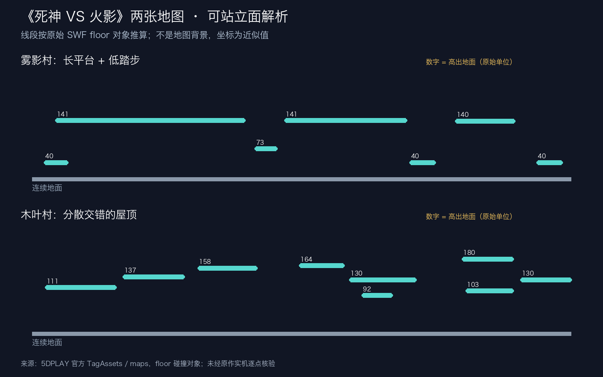

# 《死神 VS 火影》地图落脚面参考

本研究用于比较地图的**地面和平台分布**，不是原作画面复刻，也不包含原作地图素材。下图只画碰撞数据中推算出的水平落脚面，背景建筑是否能站立由碰撞数据判断，不能只看图案。

每张图横向按自身宽度铺满；竖向按原始单位采用同一比例，数字是高出地面的近似值。因此不能用两图里线段的显示长度直接比较绝对宽度。

## 原作数据与结果

数据来源为 5DPLAY 公开素材库中地图的 SWF；下列链接仅用于查证，仓库没有复制这些地图素材：

- [雾影村 wuyingcun.swf](https://github.com/5DPLAY-Game-Studio/BleachVsNaruto_TagAssets/blob/master/shared/assets/assets/packs/maps/wuyingcun/wuyingcun.swf)，本次文件 SHA-256：`fa4ebdaaf5062e3fc957cb1dfe086a4b29d06afa1a2cb9d74551add822705942`。
- [木叶村 muyecun.swf](https://github.com/5DPLAY-Game-Studio/BleachVsNaruto_TagAssets/blob/master/shared/assets/assets/packs/maps/muyecun/muyecun.swf)，本次文件 SHA-256：`9565c6ef1c9017954574957473d4926eac19744d33b6ce733c8099f8a02053bd`。
- [5DPLAY 游戏源码仓库](https://github.com/5DPLAY-Game-Studio/BleachVsNaruto)；另一个复刻工程的[地图提取脚本](https://github.com/qiulinfan/bleach-vs-naruto-pocket/blob/main/tools/convert_maps.py)可交叉参考：它从原始 SWF 的 `floor` 子对象读取可站立面及变换。

解析后的近似地图碰撞边界：

| 地图 | 地面宽度 | 高出地面 | 平台左右边界 x |
| --- | --- | --- | --- |
| 雾影村 | 约 1500 | 约 140 | 69–590、706–1040、1182–1341 |
| 雾影村 | 约 1500 | 约 40–73 | 37–97、624–679、1055–1120、1408–1473 |
| 木叶村 | 约 1000 | 约 92–180 | 27–154、171–281、310–416、498–577、591–711、614–667、800–891、807–891、909–999 |

雾影村的中高层横向覆盖较广，采用长短不一的分段，靠近边界与间隙还有低台阶。木叶村的屋顶则较碎、左右交错且分布到版边，提供不同高度的换线。可以借鉴这两种**不同的路线组织方式**，再按本游戏的角色跳跃、冲刺和镜头重新定尺寸；数值不能直接按像素照搬。

## 方法和限制

`inspect-swf.py` 是为本次记录编写的轻量只读检查工具，仅用 Python 标准库，未包含原作二进制文件。对文件执行 `python3 inspect-swf.py /path/to/map.swf`：解压 `CWS`，读取根时间线中名为 `floor` 和 `line_player_bottom` 的对象，读取 `floor` 子精灵内每个矩形的 bounds、缩放和位移，计算水平区间与高度。图表把 `line_player_bottom` 的原点作为地面近似基准。

这是一份基于资源对象的几何分析：尚未在原作实机逐点验证，也没有核实每个不同版本的地图是否一致。矩形可用于推测落脚面的分布，实际判定可能受引擎、注册点、动画以及图层影响。这里不声称地图截图里的所有屋顶都可站立，也不据此推定跳跃手感或各处的可达性；新地图必须在本游戏中让四个角色分别实测。
